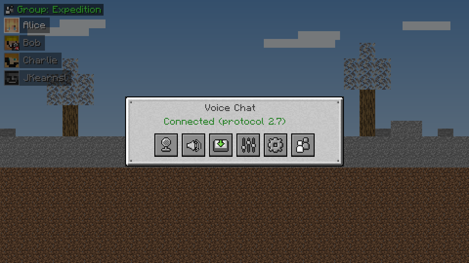
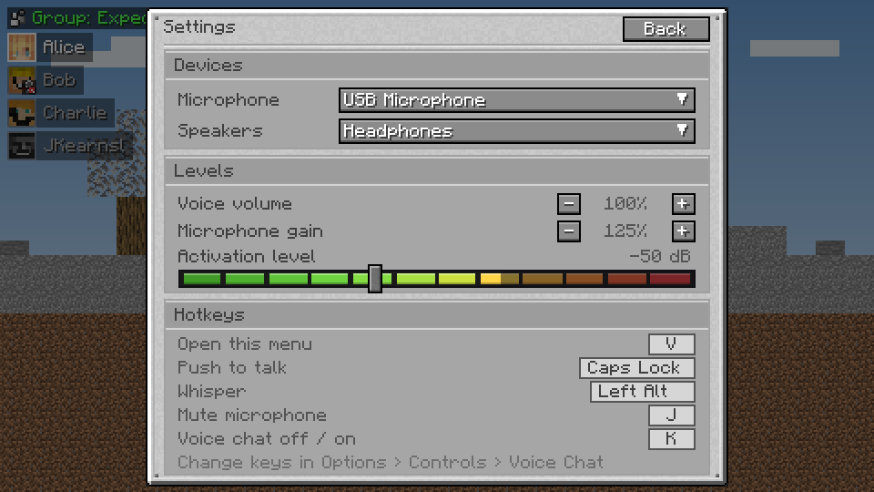
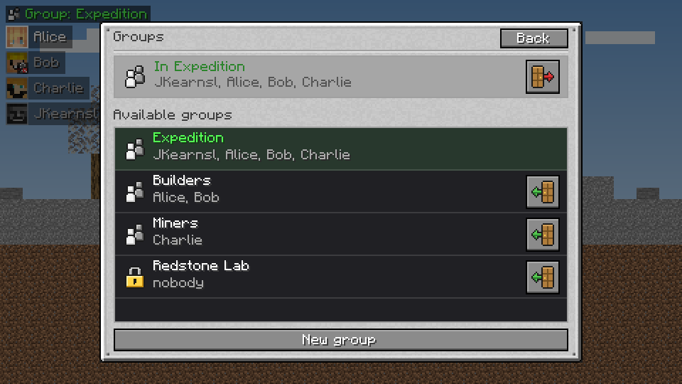
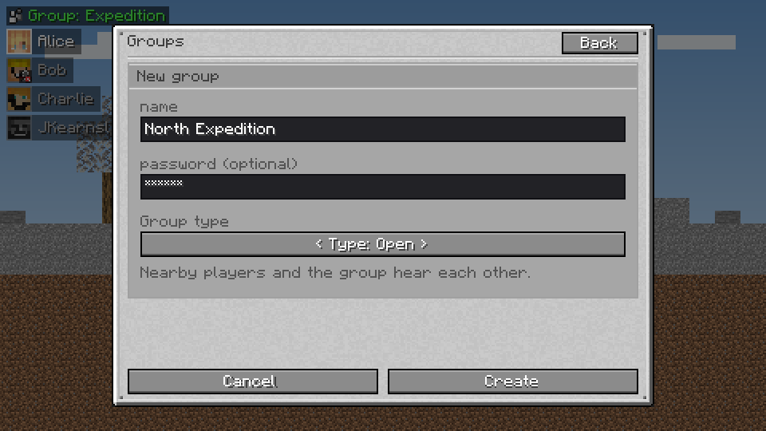
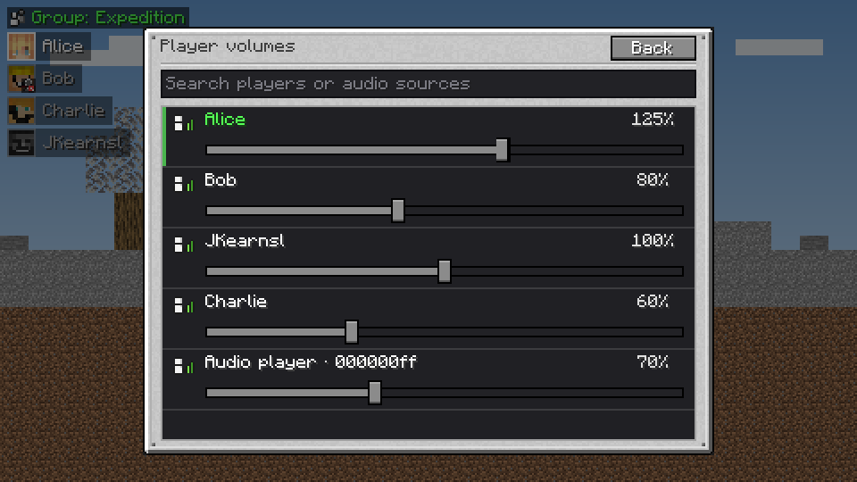

<p align="center">
  
</p>

<h1 align="center">Voice Chat</h1>

<p align="center">
  An unofficial native client for the Simple Voice Chat protocol on Horizon.
</p>


## Features

- Simple Voice Chat 2.6.x and 2.7.x protocol support.
- Proximity audio with distance attenuation and stereo positioning.
- Push-to-talk and voice activation with a live microphone meter.
- Password-protected groups, group types, and a group member roster.
- Per-player and per-source volume controls, including compatible modded audio sources.
- Speaking indicators, player heads, and group icons in the HUD.
- Interface localization in English, Russian, Ukrainian, German, Spanish, French, Brazilian Portuguese, Simplified Chinese, Polish, and Italian.

## Interface

Press **V** to open the voice controls



<details>
<summary><strong>Settings, groups, and volume controls</strong></summary>

**Settings** – select audio devices, adjust voice levels and the activation threshold, and review hotkeys.



**Groups** – see your current group, its members, and other available groups.



**Create group** – set a name, an optional password, and how the group interacts with nearby players.



**Player volumes** – search players and audio sources, then adjust each source with a slider.



</details>

## Installation

1. Download the `.hmod` package from the project's releases.
2. Add it to the instance as a native mod in Horizon Launcher.
3. Rebuild the instance. The bundled icons are loaded from the mod's assets automatically.
4. Join a server running Simple Voice Chat and press **V** to open the menu.

The server's voice UDP port must be reachable. A server without Simple Voice Chat cannot provide voice connectivity.

## Privacy and local data

While voice chat is enabled, the microphone remains open for the live level meter, including in push-to-talk mode. In push-to-talk mode, audio is sent only while PTT or Whisper is held, plus a short release tail. Captured audio is not written to disk. Disable Voice Chat closes the audio streams and clears queued microphone samples.

Voice traffic uses client-server UDP only, with no peer-to-peer connections. The Simple Voice Chat server selects the voice host and port; an empty voice host falls back to the game server's address.

The local `voice_chat-client.toml` stores audio and interface preferences, selected device names, per-player/source UUID volume overrides, and the negotiated protocol version for each server address. It does not store audio, group passwords, or voice encryption secrets.

## Compatibility

- A server running Simple Voice Chat 2.6.x or 2.7.x is required. The protocol version is negotiated automatically for each server.
- The Simple Voice Chat client mod is not required.
- The native package must match the Horizon build used by the instance. The current target is declared in `horizon-mod.toml` and validated during the build.

CI checks Stable Horizon SDK updates and prepares a draft pull request after the test suite and package validation pass.

## Building from source

Run the engine checks:

```sh
cargo test --offline
cargo test --manifest-path src/opus-rs/Cargo.toml --offline
cargo horizon-mod check
```

From the project root, build the package:

```sh
cargo horizon-mod build
```

The resulting package is written to `target/horizon-mod/voice_chat.hmod`.

## Contributing

Open an issue before starting a change, then link it from the pull request.
See [CONTRIBUTING.md](CONTRIBUTING.md) for the contribution, verification,
and AI-assisted development rules.

## Licence

Project code and original assets are available under the [MIT Licence](LICENSE).

The vendored `opus-rs` code is covered by its BSD-3-Clause licence in `COPYING.OPUS`.

Simple Voice Chat is copyright Max Henkel and marked All Rights Reserved. This project is unofficial, is not affiliated with Max Henkel, and does not include Simple Voice Chat's original assets. The name is used only to describe protocol compatibility.
